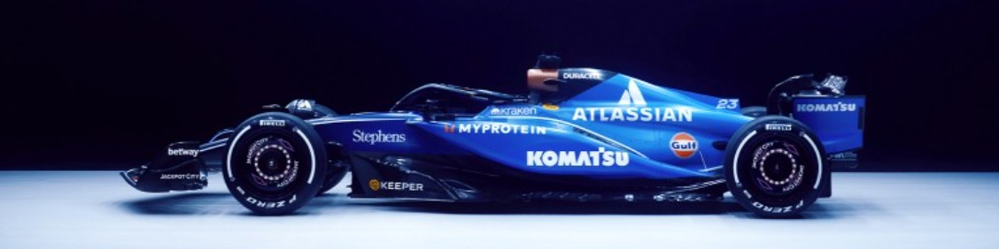

  

### About Me

Physics student @ University of Oxford with an interest in Formula One Strategy.

I am currently studying for an MSc in Mathematical and Theoretical Physics at the University of Oxford.  Graduating in July 2027, I am taking modules in "Machine Learning Fundamentals with Applications to Physics and Mathematics", "General Relativity", "Quantum Field Theory" and "Algorithms and Computations in Theoretical Physics".

In July 2026 I graduated from Durham University with First Class Honours, placing first in my cohort and winning seven academic prizes overall.

During my time at Durham, I completed a placement year and a summer placement at Williams F1 team in the Strategy Group. I was responsible for running race simulations, competitor analysis and presenting key findings to large groups including senior leadership and drivers.

 

  

